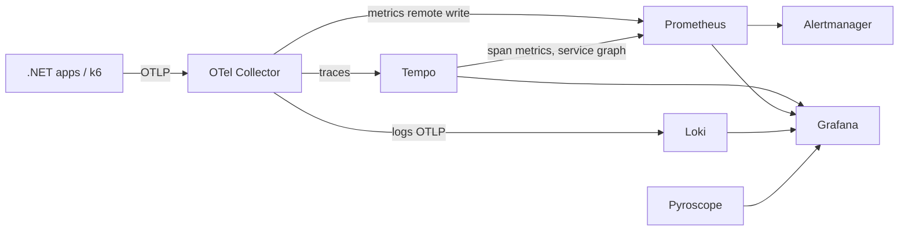

# Observatory

A local OpenTelemetry + Grafana observability lab. Applications send OTLP to one collector; metrics, traces, logs and profiles land in dedicated backends and are explored together in Grafana. Later milestones add k6 load testing, chaos tooling and comparison stacks.

Everything runs with Docker only. No cloud resources are used.

## Quick start

```powershell
docker compose up -d
```

| Component | URL | Purpose |
| --- | --- | --- |
| Grafana | http://localhost:3000 (`admin` / `admin`, anonymous viewer enabled) | Dashboards and exploration |
| Prometheus | http://localhost:9090 | Metrics, remote-write receiver, alert rules |
| Tempo | http://localhost:3200 | Traces, service graph and span metrics |
| Loki | http://localhost:3100 | Logs (OTLP ingestion) |
| Pyroscope | http://localhost:4040 | Continuous profiling |
| Alertmanager | http://localhost:9093 | Alert routing |
| OTel Collector | `localhost:4317` (gRPC), `localhost:4318` (HTTP) | Single OTLP entry point for apps |
| demo-api | http://localhost:18080 | Sample .NET API instrumented with OpenTelemetry, the target for load tests |

## Sending telemetry from an app

Point any OpenTelemetry SDK at the collector:

```
OTEL_EXPORTER_OTLP_ENDPOINT=http://localhost:4317
OTEL_SERVICE_NAME=my-service
```

From another container, join the `observatory_default` network and use `http://otel-collector:4317`.

## Data flow



## Verified end to end

A smoke test sends one trace, one log record and one metric through the collector over OTLP/HTTP. The trace is retrievable from Tempo, the log from Loki, the metric from Prometheus, and Tempo generates span metrics from the trace.

## Load testing with k6

`demo-api` exposes endpoints with different behaviour: `/api/fast`, `/api/slow` (log-normal latency), `/api/flaky` (configurable 5xx rate) and `/api/cpu` (CPU burn). The k6 scripts in `k6/` send a weighted mix of these and stream results to Prometheus, so a run is visible live in Grafana next to the server-side telemetry.

| Scenario | Purpose | Run |
| --- | --- | --- |
| smoke | Proves the system works; used as the CI gate | `docker compose --profile loadtest run --rm k6 run /scripts/smoke.js` |
| load | Expected traffic: ramp up, hold, ramp down | `... run /scripts/load.js` |
| stress | Step up to 400 VUs to find the breaking point | `... run /scripts/stress.js` |
| spike | Sudden surge, then recovery | `... run /scripts/spike.js` |
| soak | Long, steady load to expose leaks (`-e SOAK_DURATION=2h`) | `... run /scripts/soak.js` |

Every run is tagged with a `testid`, which the **k6 load test** dashboard uses to filter.

## Dashboards and alerts

Dashboards are provisioned from `dashboards/` and generated by `tools/generate-dashboards.ps1`, so they are reviewable code rather than manual clicks.

- **Service overview: demo-api**: request rate, 5xx ratio, p50/p95/p99 latency, p95 per route, active requests, CPU, memory, GC, thread pool, and application logs.
- **k6 load test**: virtual users, request rate, failures, client-side latency percentiles, client p95 against server p95, server CPU during the test.
- **Observability stack health**: scrape targets and collector throughput.

Prometheus rules in `config/prometheus/rules/` define recording rules and two alerts (`DemoApiHighErrorRatio`, `DemoApiHighLatencyP95`) that fire during stress and spike runs.

## Roadmap

- [ ] Instrument Pulse, Orderflow and Docs-Brain with OpenTelemetry
- [x] k6 scenarios (smoke, load, stress, spike, soak) writing to Prometheus
- [x] Dashboards as code: service overview and k6 results
- [ ] Dashboards: SLO burn rate and per-project views
- [x] Alert rules (error ratio and latency)
- [ ] Show alerts firing during a recorded stress test (screenshots/GIF)
- [ ] Pyroscope profiling for .NET apps
- [ ] Extras: Uptime Kuma, Toxiproxy, Seq, Aspire Dashboard
- [ ] Opt-in profiles: `elk` (Elasticsearch + Kibana) and `signoz`, with a "Loki vs Elasticsearch" write-up

## Layout

```
docker-compose.yml
config/            per-component configuration
dashboards/        Grafana dashboards as JSON (provisioned read-only)
k6/                load test scenarios and shared traffic library
src/DemoApi/       sample instrumented .NET API
tools/             dashboard generator
.github/workflows/ CI: config validation, build, k6 smoke gate
```
