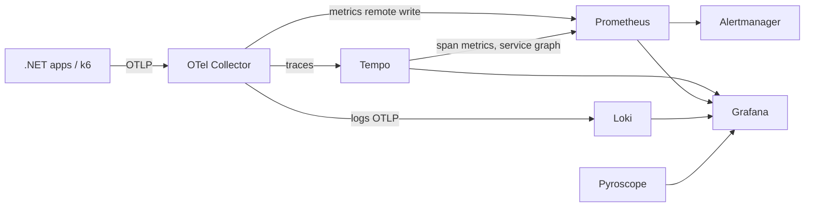

# Observatory

A local OpenTelemetry + Grafana observability lab. Applications send OTLP to one collector; metrics, traces, logs and profiles land in dedicated backends and are explored together in Grafana. Later milestones add k6 load testing, chaos tooling and comparison stacks.

Everything runs with Docker only. No cloud resources are used.

## Quick start

```powershell
docker compose up -d
```

| Component | URL | Purpose |
| --- | --- | --- |
| Grafana | http://localhost:3000 (`admin` / `admin`, anonymous viewer enabled) | Dashboards and exploration |
| Prometheus | http://localhost:9090 | Metrics, remote-write receiver, alert rules |
| Tempo | http://localhost:3200 | Traces, service graph and span metrics |
| Loki | http://localhost:3100 | Logs (OTLP ingestion) |
| Pyroscope | http://localhost:4040 | Continuous profiling |
| Alertmanager | http://localhost:9093 | Alert routing |
| OTel Collector | `localhost:4317` (gRPC), `localhost:4318` (HTTP) | Single OTLP entry point for apps |

## Sending telemetry from an app

Point any OpenTelemetry SDK at the collector:

```
OTEL_EXPORTER_OTLP_ENDPOINT=http://localhost:4317
OTEL_SERVICE_NAME=my-service
```

From another container, join the `observatory_default` network and use `http://otel-collector:4317`.

## Data flow



## Verified end to end

A smoke test sends one trace, one log record and one metric through the collector over OTLP/HTTP. The trace is retrievable from Tempo, the log from Loki, the metric from Prometheus, and Tempo generates span metrics from the trace.

## Roadmap

- [ ] Instrument Pulse, Orderflow and Docs-Brain with OpenTelemetry
- [ ] k6 scenarios (smoke, load, stress, spike, soak) writing to Prometheus
- [ ] Dashboards as code: RED/USE, latency percentiles, SLO burn rate, per-project views
- [ ] Alert rules shown firing during stress tests
- [ ] Pyroscope profiling for .NET apps
- [ ] Extras: Uptime Kuma, Toxiproxy, Seq, Aspire Dashboard
- [ ] Opt-in profiles: `elk` (Elasticsearch + Kibana) and `signoz`, with a "Loki vs Elasticsearch" write-up

## Layout

```
docker-compose.yml
config/            per-component configuration
dashboards/        Grafana dashboards as JSON (provisioned read-only)
```
