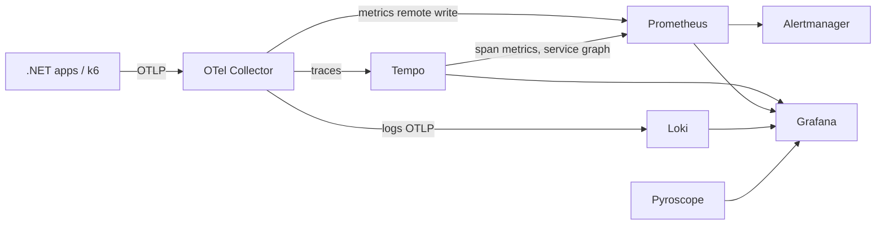
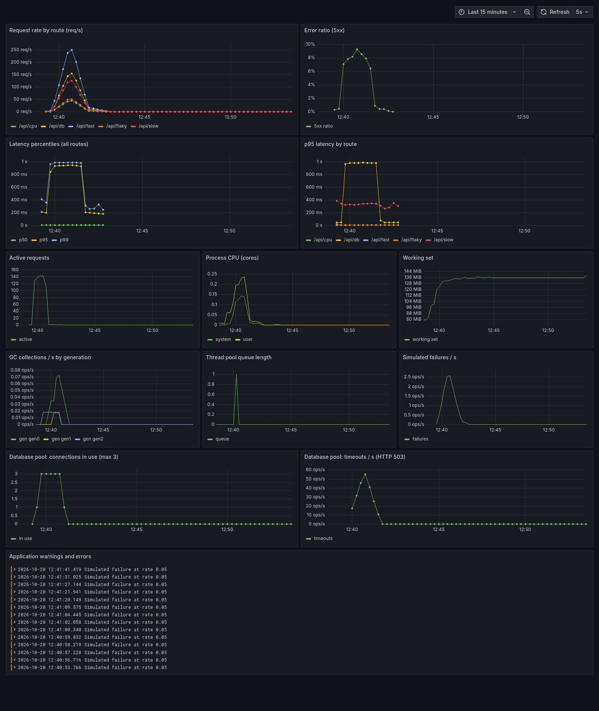
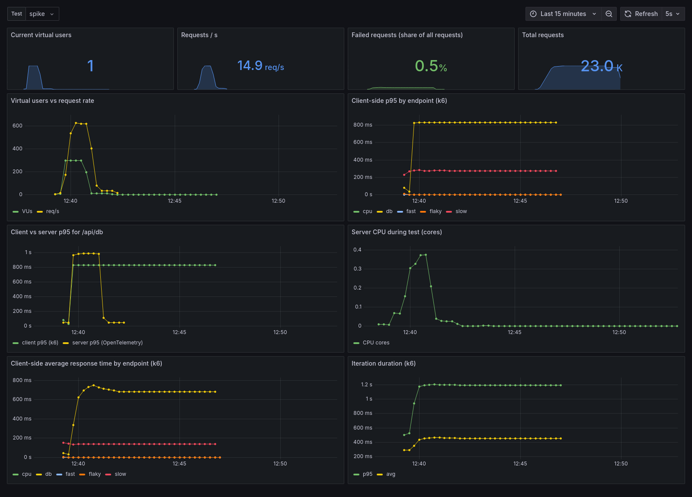
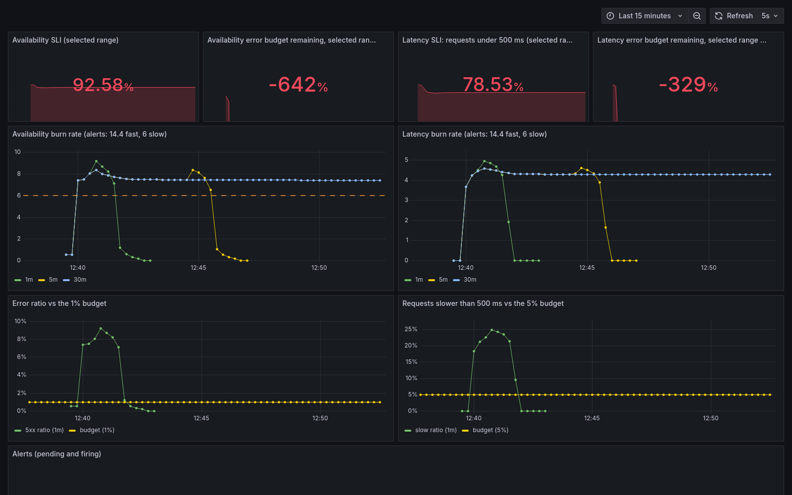

# Observatory

A local OpenTelemetry + Grafana observability lab. Applications send OTLP to one collector; metrics, traces, logs and profiles land in dedicated backends and are explored together in Grafana. Later milestones add k6 load testing, chaos tooling and comparison stacks.

Everything runs with Docker only. No cloud resources are used.

## Quick start

```powershell
docker compose up -d
```

| Component | URL | Purpose |
| --- | --- | --- |
| Grafana | http://localhost:3000 (`admin` / `admin`, anonymous viewer enabled) | Dashboards and exploration |
| Prometheus | http://localhost:9090 | Metrics, remote-write receiver, alert rules |
| Tempo | http://localhost:3200 | Traces, service graph and span metrics |
| Loki | http://localhost:3100 | Logs (OTLP ingestion) |
| Pyroscope | http://localhost:4040 | Continuous profiling |
| Alertmanager | http://localhost:9093 | Alert routing |
| OTel Collector | `localhost:4317` (gRPC), `localhost:4318` (HTTP) | Single OTLP entry point for apps |
| Image renderer | internal (used by Grafana) | Renders dashboards to PNG for screenshots |
| demo-api | http://localhost:18080 | Sample .NET API instrumented with OpenTelemetry, the target for load tests |

## Sending telemetry from an app

Point any OpenTelemetry SDK at the collector:

```
OTEL_EXPORTER_OTLP_ENDPOINT=http://localhost:4317
OTEL_SERVICE_NAME=my-service
```

From another container, join the `observatory_default` network and use `http://otel-collector:4317`.

## Data flow



## Verified end to end

A smoke test sends one trace, one log record and one metric through the collector over OTLP/HTTP. The trace is retrievable from Tempo, the log from Loki, the metric from Prometheus, and Tempo generates span metrics from the trace.

## Load testing with k6

`demo-api` exposes endpoints with different behaviour: `/api/fast`, `/api/slow` (log-normal latency), `/api/flaky` (configurable 5xx rate) and `/api/cpu` (CPU burn). The k6 scripts in `k6/` send a weighted mix of these and stream results to Prometheus, so a run is visible live in Grafana next to the server-side telemetry.

| Scenario | Purpose | Run |
| --- | --- | --- |
| smoke | Proves the system works; used as the CI gate | `docker compose --profile loadtest run --rm k6 run /scripts/smoke.js` |
| load | Expected traffic: ramp up, hold, ramp down | `... run /scripts/load.js` |
| stress | Step up to 400 VUs to find the breaking point | `... run /scripts/stress.js` |
| spike | Sudden surge, then recovery | `... run /scripts/spike.js` |
| soak | Long, steady load to expose leaks (`-e SOAK_DURATION=2h`) | `... run /scripts/soak.js` |
| outage | A dependency fails half of all requests; triggers the SLO burn-rate alerts (`-e FAILURE_RATE=0.3`) | `... run /scripts/outage.js` |

Every run is tagged with a `testid`, which the **k6 load test** dashboard uses to filter.

## Dashboards and alerts

Dashboards are provisioned from `dashboards/` and generated by `tools/generate-dashboards.ps1`, so they are reviewable code rather than manual clicks.

- **Service overview: demo-api**: request rate, 5xx ratio, p50/p95/p99 latency, p95 per route, active requests, CPU, memory, GC, thread pool, and application logs.
- **k6 load test**: virtual users, request rate, failures, client-side latency percentiles, client p95 against server p95, server CPU during the test.
- **Observability stack health**: scrape targets and collector throughput.

Prometheus rules in `config/prometheus/rules/` define recording rules and alerts that fire during stress and spike runs.

### Screenshots

Captured after a spike run (300 VUs for a minute). Panels are rendered headlessly by the bundled `renderer` container, for example `http://localhost:3000/render/d/demo-api-slo/x?kiosk&from=now-15m&to=now&width=1600&height=1000` (log in as `admin`).

**Service overview: demo-api**: request rate by route, latency percentiles, the saturated database pool, and resource usage.



**k6 load test**: virtual users, throughput, client-side latency by endpoint, and client versus server p95 for the same endpoint.



**SLO and burn rate**: SLIs, burn rates for the 1m, 5m and 30m windows against the alert thresholds, and error ratio against the budget.



### SLOs and burn rate

| SLO | Objective | Error budget |
| --- | --- | --- |
| Availability | 99% of requests do not return 5xx | 1% |
| Latency | 95% of requests finish in under 500 ms | 5% |

*Burn rate* is the observed bad-event ratio divided by the error budget. A burn rate of 1 uses exactly the budget over the SLO period; 14.4 would exhaust a 30-day budget in about two days.

Alerts follow the multiwindow, multi-burn-rate pattern from the Google SRE Workbook (`config/prometheus/rules/slo.yml`): a long window shows the problem is real and a short window shows it is still happening, so alerts are both reliable and quick to clear.

| Alert | Condition | Severity |
| --- | --- | --- |
| `*FastBurn` | burn rate > 14.4 over 5m **and** 1m | critical |
| `*SlowBurn` | burn rate > 6 over 30m **and** 5m | warning |

The windows are scaled down from the canonical 1h/5m and 6h/30m pairs so the alerts can be demonstrated within minutes of a local load test. For production, use the canonical windows.

### Results from recorded runs

Local machine, Docker Desktop, demo-api with a 3-connection database pool (`/api/db`, 25 ms per query).

**Stress** (ramp to 400 VUs, 3 minutes at the peak): about 210k requests at ~440 req/s on average.

| Phase | What the dashboards showed |
| --- | --- |
| up to ~150 VUs | p95 latency flat at ~205 ms, 0.4% errors (the `/api/flaky` baseline) |
| ~180 VUs | the pool saturates; p95 climbs from 230 ms to ~950 ms as callers queue for a connection |
| ~250 VUs and above | callers give up after 800 ms and get HTTP 503; 5xx ratio reaches ~12%, a quarter of requests exceed 500 ms |
| outcome | `DemoApiHighLatencyP95` and `DemoApiHighErrorRatio` fire; availability burn rate peaks at 12.7 (1m), below the fast-burn threshold of 14.4 |

The saturation point is visible in the **Service overview** dashboard: pool connections in use pin at 3 while latency and 503s rise together. Throughput stops growing with load, which is the signature of a bottleneck rather than a CPU limit.

**Outage** (50% of requests fail for 3 minutes): availability burn rate jumps to ~50. `DemoApiAvailabilityFastBurn` fires within about a minute and `DemoApiAvailabilitySlowBurn` after the 30-minute window confirms the trend (about 2.5 minutes in). Both alerts reach Alertmanager.

The **SLO and burn rate** dashboard shows the SLIs, remaining error budget over the selected time range, burn rates for each window against the alert thresholds, and the alerts currently pending or firing.

## Roadmap

- [ ] Instrument Pulse, Orderflow and Docs-Brain with OpenTelemetry
- [x] k6 scenarios (smoke, load, stress, spike, soak) writing to Prometheus
- [x] Dashboards as code: service overview and k6 results
- [x] SLO burn-rate dashboard and multiwindow alerts
- [ ] Per-project dashboards
- [x] Alert rules (error ratio, latency, SLO burn rate) verified firing under stress and outage runs
- [x] Screenshots of the dashboards during a run (rendered by the bundled image renderer)
- [ ] Pyroscope profiling for .NET apps
- [ ] Extras: Uptime Kuma, Toxiproxy, Seq, Aspire Dashboard
- [ ] Opt-in profiles: `elk` (Elasticsearch + Kibana) and `signoz`, with a "Loki vs Elasticsearch" write-up

## Layout

```
docker-compose.yml
config/            per-component configuration
dashboards/        Grafana dashboards as JSON (provisioned read-only)
k6/                load test scenarios and shared traffic library
src/DemoApi/       sample instrumented .NET API
tools/             dashboard generator
.github/workflows/ CI: config validation, build, k6 smoke gate
```
